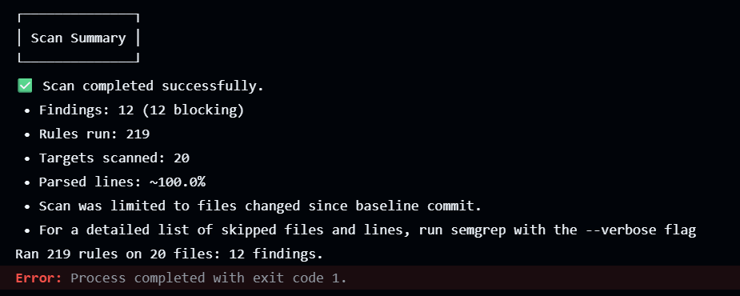
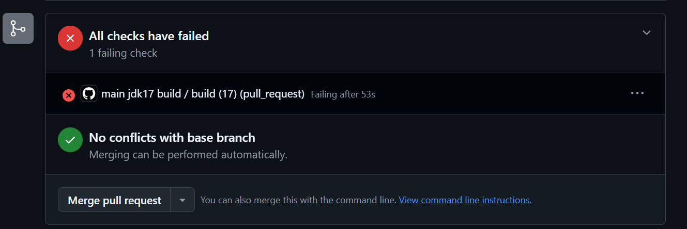
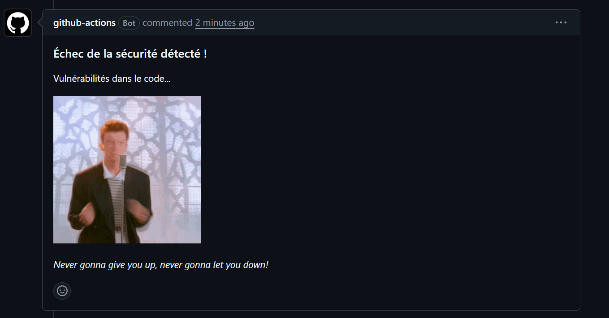

### Modification et validation du Workflow GitHub Actions

#### 1. Détection des nouvelles vulnérabilités avec Semgrep
**Choix de conception et d'implémentation :**
Nous avons configuré le workflow `.github/workflows/main-jdk17-build.yml` en exécutant directement le conteneur Docker officiel de Semgrep (`semgrep/semgrep`). 

Au début, on voulait utiliser l'action `returntocorp/semgrep-action@v1`. Le problème est qu'elle écrasait la configuration pour n'exécuter que notre dossier local `.semgrep`, ignorant les règles que nous avions écrites. Le passage au CLI officiel via Docker nous a permis de combiner trois sources de règles :
1. **`p/java` et `p/findsecbugs` :** Pour détecter les vulnérabilités classiques de l'écosystème Java (injection de commandes OS, traversal de chemin, désérialisation XML, algorithmes cryptographiques et aléatoires faibles).
2. **`.semgrep` :** Pour appliquer notre règle personnalisée (`semgrep.custom-redos`) ciblant les expressions régulières vulnérables au déni de service (ReDoS).

pour ne trouver que les nouvelles vulnérabilités, nous avons :
* Configuré l'étape `actions/checkout@v4` avec `fetch-depth: 0` pour récupérer l'historique complet des commits Git.
* Utilisé l'option `--baseline-commit "${{ github.event.pull_request.base.sha }}"` et le drapeau `--error` pour bloquer le pipeline (`exit code 1`) dès qu'une nouvelle vulnérabilité est détectée.
* Placé l'analyse Semgrep en haut de la compilation Maven pour éviter d'attendre après des tests d'intégration complets.

**Validation :**
Lors de l'exécution sur notre Pull Request, Semgrep a analysé les 7 fichiers modifiés avec 219 règles Java et a bloqué le pipeline avec succès en remontant 12 alertes bloquantes couvrant nos 7 types de vulnérabilités distinctes.
L'ajout des paquets p/owasp-top-ten et p/security-audit nous a permis de lever la 12ᵉ alerte sur OOXMLParser.java

#### 2. Implémentation du "Rickroll" (Humour)
**Choix de conception et résolution des contraintes :**
Pour le rickroll, nous avons d'abord testé l'action reccomandée `TejasvOnly/random-rickroll@v1.0`. Toutefois, cette action est conçue uniquement pour les *Issues* GitHub (`context.payload.issue`) et échouait constamment sur une Pull Request avec l'erreur `Error: No issue found`.

Pour contourner cela, nous avons développé notre propre implémentation utilisant l'action officielle `actions/github-script@v7` avec la permission `pull-requests: write` sur le `GITHUB_TOKEN`. Grâce à la condition `if: failure()`, le script s'exécute automatiquement dès que Semgrep fait échouer le build et publie un commentaire contenant le GIF animé de Rick Astley directement dans les commentaires de la PR.

---

### Vulnérabilités introduites:

#### 1. Exécution de commandes arbitraire

Fichier modifié : `ImagePreprocessor.java` (module `tika-parser-ocr-module`)

Type de vulnérabilité : Exécution de commandes arbitraire

**Justification de l'introduction de la vulnérabilité** :
Une recherche globale sur le répertoire de Tika a été faite pour chercher des occurences de mots clés entourant les utilitaires d'exécution de commandes. En utilisant un filtre pour ne chercher qu'à l'intérieur des modules authorisés pour la tâche 3, nous avons trouvé une occurence de `.execute(...)` dans la classe `ImagePreprocessor.java`. En analysant la logique de gestion des arguments de `DefaultExecutor.execute(...)`, nous avons conclu qu'il serait un bon candidat pour introduire une entrée controlée par utilisateur à l'aide d'une variable d'environnement.

**Mise en scénario** :

*Développeur* : Ajoute la fonctionnalité de pouvoir fournir des arguments additionnels à la commande de prétraitement d'image via une variable d'environnement. Afin de satisfaire les procédés qui nécessitent des prétraitements d'image spéciaux.

*Attaquant* : Assigne une valeur spécifique à la variable d'environnement afin d'obtenir la capacité à exécuter une commande arbitraire.

**Remarque** :
La première version de la vulnérabilité introduite n'a introduit que l'ajout d'une entrée vulnérable via `getenv()`. Lors de l'exécution de semgrep, nous avons remarqué que cette vulnérabilité n'avait pas été identifié. Après avoir appris à interpréter les règles de semgrep, nous avons compris que la règle de détection ne prenait pas en charge la librairie d'Apache (`org.apache.commons.exec`) ainsi que d'autres différences qui ont fait passer la vulnérabilité sous le radar. Nous l'avons donc modifiée pour rendre cette vulnérabilité détectable.

---

#### 2. Déni de service

Fichier modifié : `CleanPhoneText.java` (module `tika-core`)

Type de vulnérabilité : Déni de service

**Justification de l'introduction de la vulnérabilité** :
À l'aide d'une recherche globale par regex sur le répertoire, nous avons identifié plusieurs définitions de regex. Nous avons ensuite analysé rapidement celles-ci afin d'identifier les regex qui pourraient potentiellement être mal implémentées. Dans `CleanPhoneText.java`, nous avons trouvé le regex `cleanPhoneRegex` qui est un simple regex pour valider les numéros de téléphone. Nous l'avons modifié (avec l'aide d'un LLM) pour le rendre vulnérable à une attaque de déni de service par regex (ReDoS).

**Mise en scénario** :

*Développeur* : Modifie le regex pour supporter des formats de numéros de téléphone plus complexes, mais introduit involontairement une vulnérabilité ReDoS.

*Attaquant* : Fournit une entrée spécialement conçue pour exploiter la vulnérabilité ReDoS, provoquant un déni de service causé par une explosion de complexité dans le traitement du regex (validé via [regex101.com](https://regex101.com/?regex=%5E%28%5C%2B%3F1%5B-.%5Cs%5D%3F%29%3F%28%5C%28%3F%5Cd%7B3%7D%5C%29%3F%5B-.%5Cs%5D%3F%29%3F%28%5Cd%2B%5B-.%5Cs%5D%3F%29*%5Cd%7B4%7D%24&testString=1111111111111111111111111x&flags=gm&flavor=java&delimiter=%22)).

**Remarque** :
Nous nous sommes rendus compte que la règle de détection pour ReDoS ne s'appliquait pas à Java. Nous avons donc introduit une régle personnalisée basée sur [la règle de détection ReDoS pour C++.](https://semgrep.dev/playground/r/0xdea.c.regex-dos.raptor-regex-dos?editorMode=advanced)

---

#### 3. Générateur de nombres aléatoires prédictible

Fichier modifié : `PDFParser.java` (module `tika-parser-pdf-module`)

Type de vulnérabilité : Générateur de nombres aléatoires prédictible (CWE-338)

**Justification de l'introduction de la vulnérabilité :**
Lors de l'analyse d'un document PDF, Tika doit fréquemment extraire des ressources imbriquées (comme des images ou des polices) et les stocker temporairement. Nous avons jugé qu'il serait réaliste d'introduire une méthode générant un identifiant aléatoire. Pour introduire une vulnérabilité, nous avons utilisé `java.util.Random` au lieu de SecureRandom.

**Mise en scénario** :

*Développeur* : A besoin de générer rapidement des identifiants uniques pour isoler les fichiers extraits du PDF. Il choisit la classe standard Random ne connaissant pas le risque de sécurité.

*Attaquant* : Calcule le seed du générateur faible pour prédire les prochains noms de fichiers temporaires qui seront générés. L'attaquant peut ensuite lire des données sensibles extraites d'autres PDF sur le serveur ou écraser ces fichiers avant que l'application ne les lise.

---

#### 4. Algorithme de hachage faible

Fichier modifié : `InputStreamDigester.java` (module `tika-core`)

Type de vulnérabilité : Algorithme de hachage faible

**Justification de l'introduction de la vulnérabilité :**
Avec une recherche du mot clé `digest`, nous avons essayé de trouver des candidats pour le test de semgrep qui vérifie que les algorithmes de hachage spécifiés ne sont pas connus comme étant faibles. Pour l'introduction de cette vulnérabilité, il est un peu plus difficile de justifier l'ajout d'un algorithme plus fragile comme méthode de hachage de secour si l'algorithme initial n'existe pas. Cependant, il n'y a pas beaucoup de type de vulnérabilités différentes.

**Mise en scénario** :

*Développeur* : Introduit un algorithme de hachage de "secours" pour les cas où l'algorithme principal échoue.

*Attaquant* : Crée un fichier spécialement conçu pour générer une collision de hash, ce qui pourrait potentiellement créer des problèmes en écrasant des fichiers existants ou en contournant des contrôles d'intégrité.

---

#### 5. Désérialisation non sécurisée

Fichier modifié : `JsonMetadata.java` (module `tika-serialization`)

Type de vulnérabilité : Désérialisation non sécurisée (CWE-502)

**Justification de l'introduction de la vulnérabilité :**
Nous avons introduit une méthode lisant des données sérialisées en format XML natif Java via `java.beans.XMLDecoder`, une pratique qui pourrait être utilisée pour garder une compatibilité avec des anciens format, mais qui est considérée dangereuse en pratique.

**Mise en scénario** :

*Développeur* : Ajoute une fonctionnalité expérimentale pour permettre au système de charger de très vieilles métadonnées XML, datant d'avant la migration de Tika vers JSON. Il ignore que `XMLDecoder` permet l'instanciation de classes arbitraires lors de la lecture.

*Attaquant* : Fournit un fichier contenant un *payload* XML malveillant. Lors de la désérialisation, l'objet exécute du code à distance (RCE) sur le serveur hôte.

---

#### 6. Traversée de répertoire (Path Traversal)

Fichier modifié : `TikaInputStream.java` (module `tika-core`)

Type de vulnérabilité : Traversée de répertoire / Path Traversal (CWE-22)

**Justification de l'introduction de la vulnérabilité :**
Nous avons introduit une méthode de chargement de profil de configuration où l'entrée utilisateur est concaténée directement dans un objet `File` sans aucune validation, une erreur classique repérée immédiatement par FindSecBugs.

**Mise en scénario** :

*Développeur* : Conçoit une méthode pour charger dynamiquement un profil de détection MIME spécifique demandé par l'utilisateur. Il concatène directement le nom du profil fourni avec le chemin du dossier de configuration du serveur, sans vérifier si la chaîne contient des caractères de navigation.

*Attaquant* : Fournit un nom de profil contenant des séquences de remonte-répertoire (par exemple `..\..\..\Windows\win.ini` ). Le système résout le chemin et renvoie le contenu du fichier sensible à l'attaquant au lieu du fichier de configuration attendu.

**Remarque :**
Lors du scan avec Semgrep (paquet `findsecbugs`), cette vulnérabilité a levé deux alertes (`Findings: 2`) pour la même injection. C'est à cause de l'analyse par "taint tracking" (suivi des données contaminées) de l'outil : une première alerte est déclenchée lors de l'instanciation dangereuse de `java.io.File`, et une seconde est déclenchée lors de l'ouverture du flux avec `java.io.FileInputStream`.

---

#### 7. Faille d'entités externes XML (XXE)

Fichier modifié : `OOXMLParser.java` (module `tika-parser-microsoft-module`)

Type de vulnérabilité : Faille XML XXE (CWE-611)

**Justification de l'introduction de la vulnérabilité :**
Les documents Microsoft Office modernes (comme .docx ou .xlsx) sont sous le capot des archives contenant des fichiers XML (format OOXML). L'une des failles les plus courantes lors du traitement de ces fichiers est l'utilisation d'un parseur XML qui ne désactive pas la résolution des entités externes (DTD). Nous avons donc introduit une méthode de lecture rapide des manifestes XML vulnérable à cette attaque.

**Mise en scénario** :

*Développeur* : Ajoute un utilitaire pour analyser rapidement certains fichiers XML internes du document Office afin d'en extraire des métadonnées basiques. Il instancie le parseur avec les paramètres par défaut sans sécuriser la configuration contre les entités externes.

*Attaquant* : Fournit un faux document `.docx` (piégé) contenant un fichier XML déclarant une entité externe pointant vers un fichier local du serveur (ex: `file:///etc/passwd`). Lors de l'analyse du fichier par Tika, le parseur résout l'entité et l'attaquant parvient à lire des données sensibles ou confidentielles stockées sur le serveur.

---

### Vulnérabilités existantes détectées dans le code source

Cette section répertorie les vulnérabilités réelles (historiques ou oubliées) que notre pipeline d'analyse statique a interceptées directement dans le code source original d'Apache Tika, sans aucune injection de notre part.

**Note sur les faux positifs :** Le scan global a remonté 63 alertes, dont une vaste majorité de faux positifs liés à la règle `HARD_CODE_KEY`. L'outil a confondu des noms de constantes de métadonnées inoffensives (ex: `TITLE_PROP_KEY`, `SECURITY_PASSWORD_PROTECTED`) avec des clés cryptographiques. Après un tri manuel, nous avons isolé les véritables failles documentées ci-dessous.

#### 1. Secret codé en dur (Vulnérabilité déjà exsistante)

Fichier analysé : `PDFParser.java` (module `tika-parser-pdf-module`)

Type de vulnérabilité : Utilisation d'un mot de passe codé en dur (CWE-798)

**Justification de l'introduction de cette vulnérabilité :**
Lors de nos tests de scan avec Semgrep et le paquet findsecbugs, l'outil a levé une alerte bloquante authentique (HARD_CODE_KEY-2) sur la ligne 176 de PDFParser.java pour l'initialisation String password = "";. Nous ne l'avons pas injectée nous -même, mais nous l'avons détectée.

**Mise en scénario** :

*Développeur* : Laisse une variable de mot de passe initialisée à une chaîne vide hard-coded directement dans le code source pour faciliter le débogage local.

*Attaquant* : Inspecte le code source disponible publiquement, repère cette variable hard-coded et tente de contourner la protection des documents en forçant l'application à retomber sur ce mot de passe vide par défaut.

#### 2. Parseur XML vulnérable (XXE)

Fichier analysé : `MimeTypesReader.java` (module `tika-core`)

Type de vulnérabilité : Limitation inappropriée des entités externes XML / XXE (CWE-611)

**Justification de la documentation de cette vulnérabilité :**
La règle `saxparserfactory-disallow-doctype-decl-missing` a détecté à la ligne 223 que la classe `SAXParserFactory` est instanciée sans que la fonctionnalité interdisant les déclarations `DOCTYPE` ne soit activée. Il s'agit d'une faille très courante dans les applications Java matures traitant des fichiers de configuration XML.

**Mise en scénario** :

*Développeur* : Utilise le parseur XML natif de Java avec sa configuration par défaut pour lire le fichier de définition des types MIME (`tika-mimetypes.xml`), sans penser à désactiver la résolution des entités externes.

*Attaquant* : Si l'application permet à un utilisateur de fournir un fichier de configuration MIME personnalisé, l'attaquant peut y injecter une entité externe pointant vers un fichier local du serveur. Lors de la lecture par Tika, le fichier système cible sera exfiltré.

#### 3. Communication réseau non chiffrée

Fichier analysé : `NetworkParser.java` (module `tika-core`)

Type de vulnérabilité : Transmission d'informations sensibles en clair (CWE-319)

**Justification de la documentation de cette vulnérabilité :**
La règle `unencrypted-socket` a intercepté la ligne 68 (`try (Socket socket = new Socket(uri.getHost(), uri.getPort()))`). La classe ouvre un flux de communication (Socket) brut, sans exiger de couche de chiffrement SSL/TLS (`SSLSocketFactory`), ce qui expose le trafic.

**Mise en scénario** :

*Développeur* : Implémente un parseur capable d'aller chercher et lire des documents hébergés sur un réseau distant en utilisant des Sockets Java standards pour plus de simplicité et de compatibilité.

*Attaquant* : Se positionne sur le réseau (attaque de type Man-in-the-Middle ou *sniffing*) et intercepte les paquets de données transférés par le Socket. Puisque la connexion n'est pas chiffrée, l'attaquant peut lire ou altérer les documents pendant leur transfert vers le parseur Tika.

---