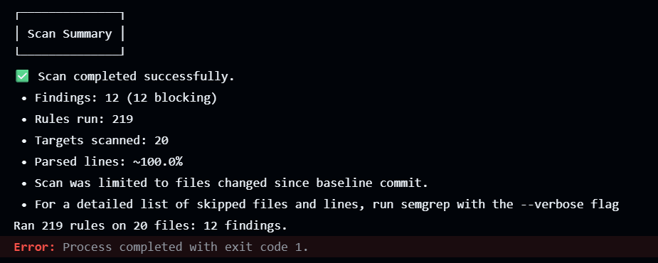
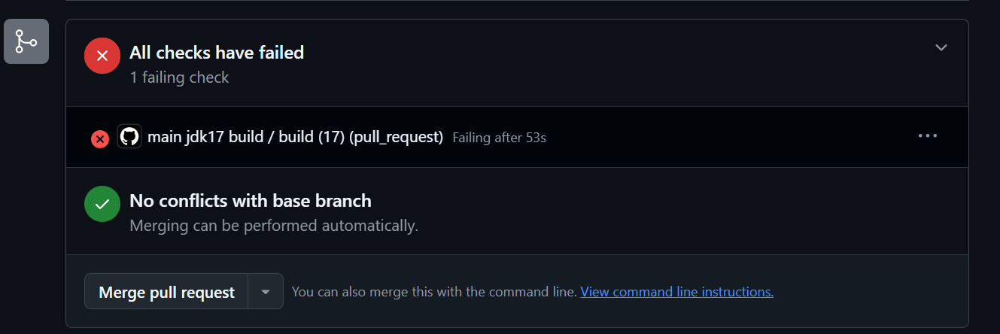
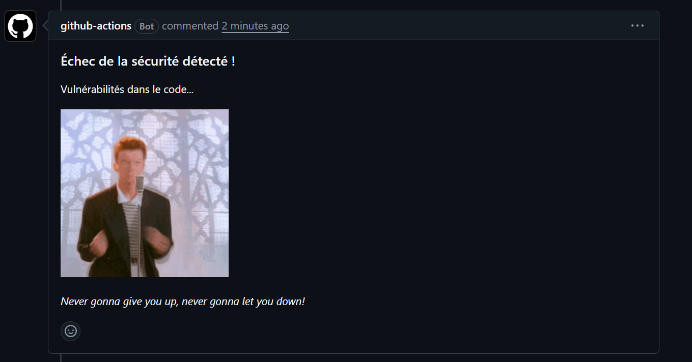

### Modification et validation du Workflow GitHub Actions

#### 1. Détection des nouvelles vulnérabilités avec Semgrep
**Choix de conception et d'implémentation :**
Nous avons configuré le workflow `.github/workflows/main-jdk17-build.yml` en exécutant directement le conteneur Docker officiel de Semgrep (`semgrep/semgrep`). 

Au début, on voulait utiliser l'action `returntocorp/semgrep-action@v1`. Le problème est qu'elle écrasait la configuration pour n'exécuter que notre dossier local `.semgrep`, ignorant les règles que nous avions écrites. Le passage au CLI officiel via Docker nous a permis de combiner trois sources de règles :
1. **`p/java` et `p/findsecbugs` :** Pour détecter les vulnérabilités classiques de l'écosystème Java (injection de commandes OS, traversal de chemin, désérialisation XML, algorithmes cryptographiques et aléatoires faibles).
2. **`.semgrep` :** Pour appliquer notre règle personnalisée (`semgrep.custom-redos`) ciblant les expressions régulières vulnérables au déni de service (ReDoS).

pour ne trouver que les nouvelles vulnérabilités, nous avons :
* Configuré l'étape `actions/checkout@v4` avec `fetch-depth: 0` pour récupérer l'historique complet des commits Git.
* Utilisé l'option `--baseline-commit "${{ github.event.pull_request.base.sha }}"` et le drapeau `--error` pour bloquer le pipeline (`exit code 1`) dès qu'une nouvelle vulnérabilité est détectée.
* Placé l'analyse Semgrep en haut de la compilation Maven pour éviter d'attendre après des tests d'intégration complets.

**Validation :**
Lors de l'exécution sur notre Pull Request, Semgrep a analysé les 7 fichiers modifiés avec 219 règles Java et a bloqué le pipeline avec succès en remontant 12 alertes bloquantes couvrant nos 7 types de vulnérabilités distinctes.
L'ajout des paquets p/owasp-top-ten et p/security-audit nous a permis de lever la 12ᵉ alerte sur OOXMLParser.java

#### 2. Implémentation du "Rickroll" (Humour)
**Choix de conception et résolution des contraintes :**
Pour le rickroll, nous avons d'abord testé l'action reccomandée `TejasvOnly/random-rickroll@v1.0`. Toutefois, cette action est conçue uniquement pour les *Issues* GitHub (`context.payload.issue`) et échouait constamment sur une Pull Request avec l'erreur `Error: No issue found`.

Pour contourner cela, nous avons développé notre propre implémentation utilisant l'action officielle `actions/github-script@v7` avec la permission `pull-requests: write` sur le `GITHUB_TOKEN`. Grâce à la condition `if: failure()`, le script s'exécute automatiquement dès que Semgrep fait échouer le build et publie un commentaire contenant le GIF animé de Rick Astley directement dans les commentaires de la PR.

